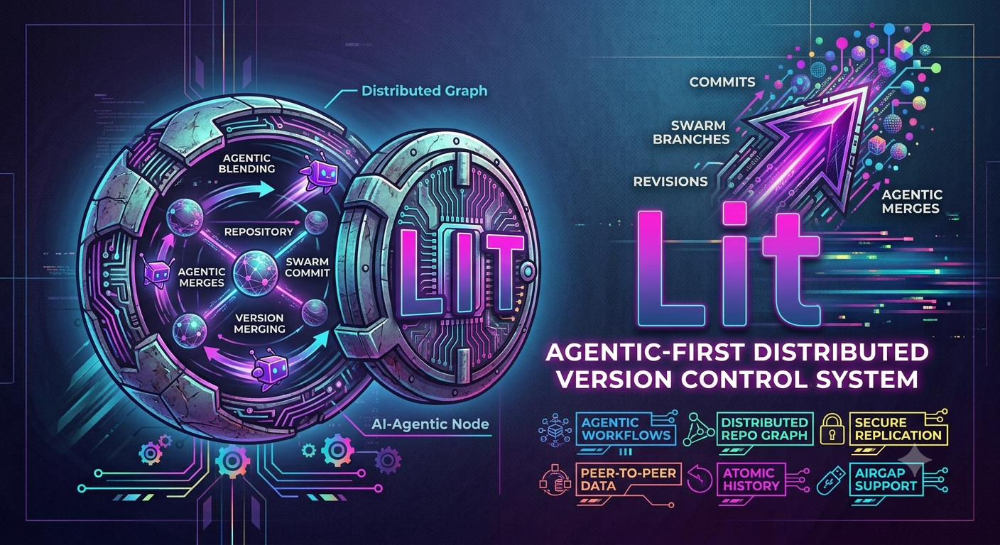

# 

[English](README.md) | 简体中文

**全球首个为 AI 智能体优先、人类其次而设计的通用版本控制系统。**

Lit 是一个用 Rust 编写的完整 Git 替代品 —— 67 个命令、30 个 MCP 工具、后量子密码学安全、受限命令执行、结构化的机器可读输出。每个接口都为自主智能体工作流而设计，通过一个开关也能为人类提供友好的输出。

与 Git 不同，Lit 不限于源代码。它的可插拔内容类型系统可以对 **CAD 模型、EDA 原理图、手稿、数据库、科研数据集、媒体资源、地理空间数据** 以及任何其他领域内容进行版本管理 —— 并采用符合领域特性的 diff、merge 和存储策略。任意智能体档案让 CAD 设计师、EDA 工程师、技术文档作者、DBA 和数据科学家能与软件智能体在同一个版本化工作区中协同。数据中心部署特性支持集群分片、复制、健康监控和 Prometheus 风格指标，以满足生产规模的运维需求。

## 为什么选择 Lit？

Git 诞生于 2005 年，面向的是使用终端的人类开发者。它的每个接口 —— 输出格式、错误信息、交互式提示、冲突标记 —— 都假设有一个人在阅读并作出回应。AI 智能体必须用脆弱的正则表达式去解析 Git 的自由文本输出，绕开交互式提示，并把 `<<<<<<<` 冲突标记翻译成可操作的东西。

**Lit 把这一切颠倒过来。** 每条命令默认输出结构化 JSON。错误附带机器可执行的码和修复建议。合并冲突是结构化对象，而不是文本标记。批量操作从 stdin 接受 JSONL。任何情况下都不会提示输入。人类通过 `--human` 开关获得同样的能力。

|                    | Git                         | Lit                                      |
| ------------------ | --------------------------- | ---------------------------------------- |
| **设计对象**       | 人类开发者                  | AI 智能体（同时支持人类）                |
| **默认输出**       | 自由文本                    | 结构化 JSON                              |
| **错误处理**       | 自由字符串                  | 类型化错误码 + 修复建议                  |
| **批量操作**       | Shell 脚本                  | 原生 JSONL 批量模式                      |
| **API 访问**       | 第三方包装                  | 内置 REST + MCP + `lit://` + stdio       |
| **合并冲突**       | `<<<<<<<` 标记              | 结构化冲突对象                           |
| **智能体元数据**   | 提交信息约定                | 一等公民的元数据字段                     |
| **智能体协调**     | 无                          | 集群注册、文件租约                       |
| **智能体工作流**   | 分支 → PR → 合并            | 意图 → 提交 → 汇聚                       |
| **身份**           | 无                          | 基于 DID 的身份、UCAN 委托               |
| **信任评分**       | 无                          | 按智能体追踪声誉                         |
| **议题与 PR**      | 无内置                      | 本地优先，存为 git refs                  |
| **联邦**           | 中心化（GitHub/GitLab）     | 内容寻址的点对点                         |
| **受限执行**       | 无                          | 操作系统强制的限制，并逐主机报告实际生效了哪些 |
| **内容类型**       | 仅源代码                    | CAD、EDA、CAM、仿真、AI 模型、手稿、数据库、媒体等 |
| **智能体类型**     | 不适用                      | SWE、CAD、EDA、作者、DBA、评审、CI       |
| **数据中心**       | 不适用                      | 分片、复制、指标、健康检查               |
| **密码学**         | SHA-1 / SHA-256             | SHA3-512 + BLAKE3（抗量子）              |
| **签名**           | GPG / SSH                   | ML-DSA-87（NIST FIPS 204）               |
| **加密**           | 无内置                      | 静态 AES-256-GCM，传输 TLS 1.3           |
| **合规**           | 无                          | FIPS 140-3，启动时自动自检               |
| **交互式提示**     | 频繁                        | 从不（零提示设计）                       |

## 特性

- **67 个 CLI 命令** —— 完整的 Git 等价工作流，外加面向智能体的扩展
- **30 个 MCP 工具** —— LLM 智能体通过 Model Context Protocol 工具调用来交互
- **去中心化身份** —— 基于 DID 的身份，支持 Ed25519 与 ML-DSA-87 后量子密钥
- **UCAN 能力委托** —— 细粒度权限令牌。可以签发、列出和撤销；**但尚未被用于任何访问决策**，且当前的令牌签名并不是一种签名方案 —— 在基于此构建之前，请阅读 `src/identity/ucan.rs` 中的警告
- **智能体信任评分** —— 带事件驱动信任等级的声誉追踪
- **本地优先的议题与 PR** —— 议题追踪器和拉取请求存为 git refs
- **事件订阅** —— 订阅仓库事件（提交、分支、合并）
- **智能体任务委派** —— 智能体之间委派工作的结构化协议
- **内容寻址联邦** —— 带 want-list 协商的点对点仓库同步
- **4 种传输协议** —— HTTPS、SSH、`lit://`（自定义 TCP）、stdio 管道
- **自建服务器** —— `lit server serve` 提供具名账户、四种角色、过期会话、账户锁定、TLS、认证前系统使用声明，以及为每次授权决策生成 HMAC 链式审计记录。在 [`docs/NIST_800-171.md`](docs/NIST_800-171.md) 中按 NIST SP 800-171r3 逐条映射，包括存在的差距
- **受限执行** —— 针对工作树副本运行命令，经由 [`hv2-sandbox`](https://crates.io/crates/hv2-sandbox)：Linux 上使用 namespaces、`pivot_root`、cgroup v2 和 `no_new_privs`；Windows 上使用作业对象的内存、进程和 CPU 上限。每次运行都会报告宿主机**实际**强制了哪些控制项，以及其余各项未生效的原因 —— `--strict` 会拒绝执行而不是在限制不足的情况下继续。参见 [沙箱](#沙箱)
- **意图 → 提交 → 汇聚** —— 用带作用域的意图、提交挂载和信任门控的汇聚，取代分支/PR 工作流
- **通用内容类型** —— 100 种内置类型，使 Lit 成为现代工程的一站式 VCS：CAD 与 3D 建模（STEP、IGES、STL、3MF、DWG/DXF、SolidWorks、CATIA、Inventor、Fusion 360、Creo、Siemens NX、Solid Edge、Rhino、Parasolid、ACIS、JT、OBJ、FBX、glTF/GLB、USD、COLLADA、PLY、Blender、Alembic）、EDA（KiCad、Gerber、Excellon、Altium、EAGLE、OrCAD、Verilog/SystemVerilog、VHDL、GDSII、OASIS、IPC-2581、Touchstone、LEF/DEF、SPICE）、CAM（G-code、STEP-NC、APT、Mastercam）、仿真/FEA/CFD（Nastran、Abaqus、ANSYS、LS-DYNA、OpenFOAM、COMSOL、Gmsh、VTK、CGNS、Exodus、Modelica、Simulink、FMU）、AI/ML 模型（ONNX、SafeTensors、PyTorch、TensorFlow、Keras、GGUF/GGML、TensorRT、Core ML、TFLite、NumPy、checkpoints），以及手稿、数据库、科研数据、媒体、地理空间、法律和金融格式 —— 每种都有符合领域特性的 diff、merge 和存储策略
- **数据中心部署** —— 集群节点管理、一致性哈希分片、可配置复制（同步/异步/半同步）、健康监控、Prometheus 风格指标、连接池和大对象分块传输
- **通用智能体档案** —— 10 种内置档案（SWE、CAD 设计师、EDA 工程师、作者、DBA、评审、CI bot、安全审计员、数据科学家、编排器），含能力、信任等级、内容类型亲和性、资源限制和基于路径的访问控制
- **集群协调** —— 多智能体注册、文件租约和无冲突并发访问
- **后量子签名** —— ML-DSA-87（NIST FIPS 204，安全等级 5）
- **FIPS 140-3 合规** —— AES-256-GCM、PBKDF2-HMAC-SHA512，启动时自动执行已知答案测试
- **气隙模式** —— 面向涉密环境的完全网络隔离（仅 USB、文件共享）
- **原子事务** —— begin/commit/rollback 多操作序列
- **大文件存储** —— 二进制资产的 LFS 追踪与迁移
- **Git 互操作** —— 与已有 Git 仓库双向导入/导出
- **命令本体** —— 供智能体发现和 SDK 生成的机器可读类型图
- **JSON Schema** —— 为所有命令输入/输出自动生成的 draft 2020-12 模式
- **按 IP 限流** —— 所有服务端点上的滑动窗口节流（100 请求 / 60 秒）
- **防篡改审计日志** —— HMAC-SHA256 签名、仅追加的操作日志

## 安装

```bash
cargo build --release
cargo install --path .
```

Linux、macOS 和 Windows 的预构建二进制文件可在 [Releases](https://github.com/nervosys/Lit/releases) 页面获取。

## 快速开始

### 面向智能体（JSON 输出 —— 默认）

```bash
# 初始化
lit init
# → {"status":"ok","command":"init","path":"/path/to/repo"}

# 暂存并提交
lit add src/
lit commit -m "implement feature X"
# → {"status":"ok","command":"commit","hash":"abc123...","tree":"def456..."}

# 查看状态
lit status
# → {"status":"ok","command":"status","branch":"main","staged":[],"modified":[],"clean":true}

# 通过 stdin 传入 JSONL 执行批量操作
echo '{"op":"add","files":["src/a.rs"]}
{"op":"commit","message":"fix bug"}' | lit batch
```

### 面向人类

```bash
# 使用 --human 或 -H 获得熟悉的输出
lit status --human
lit log --human
lit diff --human

# 或全局设置
export LIT_OUTPUT=human
```

## 命令（65+）

### 版本控制

```bash
lit init [--bare] [path]           # 初始化仓库
lit add <files...>                 # 暂存文件
lit commit -m <message> [--intent <id>]  # 记录变更（可挂载到意图）
lit status                         # 显示工作树状态
lit log [--count N]                # 显示提交历史
lit diff [--word-diff] [--stat]    # 显示变更（结构化 hunk）
lit show <object>                  # 检视任意对象
lit branch [name] [--delete]       # 管理分支
lit checkout <target> [-b]         # 切换分支
lit merge <branch>                 # 合并分支（三路）
lit resolve <file> --strategy=X    # 编程式冲突解决
lit tag <name> [--sign]            # 创建标签（可选后量子签名）
lit stash [push|pop|apply|list|drop] # 暂存进行中的工作
lit reset [--soft|--mixed|--hard]  # 移动 HEAD
lit revert <commit>                # 创建反向提交
lit cherry-pick <commit>           # 应用指定提交
lit rebase <base>                  # 重放提交
lit blame <file>                   # 逐行作者归属
lit bisect <start|good|bad|reset>  # 二分查找引入 bug 的提交
lit reflog                         # 引用更新历史
```

### 远程操作

```bash
lit remote add <name> <url>        # 添加远程
lit push <remote> <branch>         # 推送到远程（可用 --force）
lit pull <remote> <branch>         # 拉取并合并
lit clone <url> [directory]        # 克隆仓库
lit fetch <remote> [branch]        # 下载但不合并
```

支持的传输方式：HTTPS、SSH、`lit://`（自定义 TCP）、`file://`、USB/可移动介质、网络共享。

### 智能体命令

```bash
lit batch                          # 从 stdin 执行 JSONL 操作
lit serve --port 3000              # 启动 HTTP REST API 服务器
lit serve --stdio                  # 启动 stdio JSON 管道服务器
lit serve --daemon                 # 启动 lit:// TCP 守护进程
lit mcp-serve --stdio              # 启动 MCP 工具服务器（stdio）
lit mcp-serve --port 8385          # 启动 MCP 工具服务器（HTTP）
lit tx <begin|commit|rollback>     # 原子事务模式
lit snapshot -m <msg>              # 一步完成 add-all + commit
lit search <query>                 # 跨历史全文搜索
lit watch                          # 将文件系统变更事件以 JSON 输出
lit ontology                       # 输出命令本体供智能体发现
lit schema [--command <id>]        # 从本体生成 JSON Schema（draft 2020-12）
```

### 集群协调

```bash
lit swarm register <agent-id>      # 在集群中注册智能体
lit swarm list                     # 列出已注册智能体
lit swarm lease-acquire --agent <id> --path <file> --duration 300
                                   # 获取独占文件租约（秒）
lit swarm lease-release --agent <id> --path <file>
                                   # 释放文件租约
lit swarm lease-list               # 列出所有活动租约
```

### 沙箱

针对工作树的副本运行命令，并清理环境变量：

```bash
lit sandbox init [name]                    # 从工作树创建沙箱
lit sandbox run <name> -- <cmd>            # 运行，在宿主机允许的范围内受限
lit sandbox run <name> --strict -- <cmd>   # 宁可拒绝，也不在限制不足时运行
lit sandbox run <name> --allow-network -- <cmd>
lit sandbox list                           # 列出所有沙箱
lit sandbox destroy <name>                 # 删除沙箱
```

> **能限制到什么程度取决于你的宿主机，而且它会告诉你到底限制了哪些。**
>
> 早期版本宣称提供了带文件系统和网络围栏的进程隔离，实际上什么都没提供 —— 只有一个工作目录和一次环境变量清理，没有任何内核强制的限制。现在它经由
> [`hv2-sandbox`](https://crates.io/crates/hv2-sandbox) 运行，该库会强制宿主机能做到的一切，并**把做不到的部分如实报告，而不是含糊带过**。
>
> 每次运行都会打印 `controls_enforced` 和 `controls_unenforced`，后者附带每一处差距的原因。传入 `--strict` 可让它在限制不足时拒绝运行，而不是继续执行。

在 Windows 上后端是作业对象，因此一次运行会报告类似下面的内容：

```json
"controls_enforced": ["memory-limit","process-count-limit","cpu-time-limit","wall-clock-deadline"],
"controls_unenforced": [
  "network-isolation: 作业对象不隔离网络；请使用 microVM 沙箱",
  "process-isolation: 作业对象限定了一个进程集合，但不会隐藏进程表的其余部分",
  "no-new-privileges: Windows 没有 no-new-privileges 位；受限令牌是语义不同的另一种机制"
]
```

Linux *能*做到的最多 —— namespaces、`pivot_root`、cgroup v2、`no_new_privs` —— 但不要假定它做到了。根据该 crate 自身 CI 在 GitHub `ubuntu-latest` 上的实测，一个非特权用户只能拿到 **4 项中的 1 项**  containment 控制：AppArmor 的 `kernel.apparmor_restrict_unprivileged_userns=1`（近期 Ubuntu 的默认值）会阻止用户命名空间的 id-map 写入，而命名空间一旦失效，网络、进程*和*文件系统隔离也随之失效。没有可写的 cgroup 层级，还会再搭上内存和进程数上限。

在你自己掌控的宿主机上把它补回来需要两件事：将上述 sysctl 设为 `0`（或用一个允许调用程序使用用户命名空间的 AppArmor profile），以及委派出给到你用户的 cgroup —— 例如在 `systemd-run --user --scope -p Delegate=yes ...` 下运行，或在带有 `Delegate=yes` 的服务中运行。macOS 只能得到 `RLIMIT_*`。

你不应该需要靠这篇 README 才能了解到这一点。`controls_unenforced` 中的每一项都带有来自宿主机自身的原因说明，指明是哪种机制拒绝了、以及绕过去的方法，所以那次不达标的运行本身就会告诉你该怎么修。

**这正是这份报告存在的理由。** 即便是平台级别的经验法则 —— "Linux 是强的那个" —— 也经常错到危险的地步。关于某次运行唯一可信的陈述，就是那次运行、在那台主机上、以那个用户身份给出的 `controls_enforced`。

**任何平台上都不请求文件系统隔离。** 限制文件系统意味着要给后端一个可 pivot 进去的根，以及一组以只读方式挂载的宿主机路径；而沙箱目录是你工作树的一份副本，不是一个根文件系统 —— 一个被 pivot 进去的工作负载会找不到它自己的任何工具。选择那组挂载点是设计决策，不是默认值。

所以：Linux 上是真正的限制，Windows 上是资源上限，两种情况下都如实说明是哪一种。不要推断出比 `controls_enforced` 所声明的更多的内容。

无论哪个平台都会施加的环境卫生措施：

| 措施       | 效果                                                      |
| ---------- | --------------------------------------------------------- |
| 工作目录   | 工作树复制到 `.lit/sandboxes/<name>/`，cwd 设在那里        |
| 环境变量   | 先 `env_clear()`，再设置一个小的允许列表                   |
| Home / Temp | HOME、USERPROFILE、TEMP、TMP 重定向到沙箱内              |
| PATH        | 限制为系统目录                                            |
| Git 配置   | `GIT_CONFIG_NOSYSTEM=1`，因此不读取系统配置               |
| 凭证       | 不继承 —— 环境中没有云令牌、SSH agent 或 API key          |

注意上面的 `LIT_AIRGAPPED=1` 只有 Lit 自己遵守，其他程序不认 —— 它不是网络围栏。网络阻断（凡是被强制执行的场合）来自沙箱后端，并出现在 `controls_enforced` 中。

### 身份与信任

```bash
lit did generate [--method ed25519|ml-dsa-87]  # 生成 DID 身份
lit did show                                   # 显示当前身份
lit did resolve <did>                          # 将 DID 解析为其文档
lit ucan issue <audience> --resource <r> --action <a>  # 签发 UCAN 令牌
lit ucan list [audience]                       # 列出 UCAN 令牌
lit ucan revoke <cid>                          # 撤销 UCAN 令牌
lit trust show <did>                           # 显示智能体信任分
lit trust list                                 # 列出所有被追踪的智能体
lit trust history <did>                        # 显示信任事件历史
```

### 议题与拉取请求

```bash
lit issue create <title> [--body <b>] [--label <l>]    # 创建议题
lit issue list [--state open|closed|all]                # 列出议题
lit issue show <id>                                     # 显示议题
lit issue close <id>                                    # 关闭议题
lit issue comment <id> <body>                           # 给议题评论
lit pr create <title> --head <branch> [--base main]     # 创建 PR
lit pr list [--state open|merged|closed|all]             # 列出 PR
lit pr show <id>                                         # 显示 PR
lit pr merge <id>                                        # 合并 PR
lit pr close <id>                                        # 关闭 PR
lit pr comment <id> <body>                               # 给 PR 评论
```

### 意图 → 提交 → 汇聚

声明带作用域的意图、挂载提交、汇聚工作 —— 取代分支 → PR → 合并这套仪式：

```bash
lit intent create <title> --agent <id> --scope <paths...>  # 声明一个带作用域的工作单元
lit intent list [--status active] [--agent <id>]           # 列出意图
lit intent show <intent-id>                                # 显示意图详情
lit intent close <intent-id>                               # 放弃一个意图
lit commit -m <msg> --intent <intent-id>                   # 将提交挂载到意图
lit converge <intent-id> [--strategy auto|squash|rebase|accumulate]
                                                           # 将意图合入主线
lit converge <intent-id> --dry-run                         # 预览汇聚结果
lit converge <intent-id> --verify                          # 先校验提交对象
```

意图会自动为其作用域获取集群租约、检测与其他活动意图的作用域冲突，并支持层次化分解（父子意图）。`accumulate` 策略会等待所有子意图汇聚后再合并父意图。

### 内容类型注册表

注册、检测和管理用于领域特定版本控制的内容类型。100 种内置类型使 Lit 成为现代工程的一站式 VCS —— 覆盖 CAD、3D 建模、EDA、CAM、仿真（FEA/CFD）、AI/ML 模型、手稿、数据库、科研数据、媒体、地理空间等等，每种都有相应的 diff、merge 和存储策略：

```bash
lit content-type list                            # 列出所有已注册的内容类型
lit content-type list --domain cad               # 按领域过滤
lit content-type show cad/step                   # 显示 STEP CAD 类型详情
lit content-type show db/sqlite                  # 显示 SQLite 数据库类型
lit content-type detect model.step circuit.kicad_pcb  # 自动检测文件类型
lit content-type register custom/my-format \     # 注册自定义类型
    --name "My Format" --domain scientific \
    --extensions h5x,hdf --diff-strategy structural \
    --merge-strategy schema-aware --storage-tier chunked
```

内置领域：**software**、**cad**（STEP、IGES、STL、3MF、DWG/DXF、SolidWorks、CATIA、Inventor、Fusion 360、Creo、Siemens NX、Solid Edge、Rhino、Parasolid、ACIS、JT、OBJ、FBX、glTF/GLB、USD、COLLADA、PLY、Blender、Alembic、3DS）、**eda**（KiCad PCB/原理图、Gerber、Excellon、Altium、EAGLE、OrCAD、Verilog/SystemVerilog、VHDL、GDSII、OASIS、IPC-2581、Touchstone、LEF/DEF、SPEF、SPICE）、**cam**（G-code、STEP-NC、APT、Mastercam）、**simulation**（Nastran、Abaqus、ANSYS、LS-DYNA、OpenFOAM、COMSOL、Gmsh、VTK、CGNS、Exodus、Modelica、Simulink、FMU）、**ml-model**（ONNX、SafeTensors、PyTorch、TensorFlow、Keras、GGUF/GGML、TensorRT、Core ML、TFLite、NumPy、pickle、checkpoints、joblib）、**manuscript**（LaTeX、DOCX、Typst、AsciiDoc）、**database**（SQLite、CSV、Parquet、SQL 迁移）、**scientific**（HDF5、FITS、Jupyter）、**media**（图像、视频、音频）、**geospatial**（GeoJSON、Shapefile）、**legal**（PDF）、**financial**（Excel）、**config**（Terraform、Kubernetes）。

每种内容类型规定：
- **Diff 策略** —— text、binary、structural、semantic 或 opaque
- **Merge 策略** —— 3-way text、manual-resolve、schema-aware、component-level、append-only 或 last-writer-wins
- **存储层级** —— standard、LFS、chunked 或 external
- **元数据模式** —— 用于领域特定字段的 JSON Schema 片段（三角面数、PCB 层数、表结构等）

### 数据中心部署

面向生产数据中心部署的集群管理、分片、复制、健康监控和 Prometheus 风格指标：

```bash
lit datacenter status                             # 显示集群概览
lit datacenter register-node node-1 \             # 注册集群节点
    --name "us-east-primary" --endpoint 10.0.1.1:9418 \
    --region us-east-1 --role primary
lit datacenter configure \                        # 配置集群参数
    --replication-factor 3 --shard-strategy consistent-hash \
    --replication-mode semi-sync --write-concern 2 \
    --metrics-enabled true --metrics-port 9090
lit datacenter health                             # 对所有节点执行健康检查
lit datacenter metrics                            # 采集 Prometheus 风格指标
lit datacenter remove-node node-1                 # 排空并移除节点
```

**特性：**
- **一致性哈希分片** —— 通过虚拟分片环将对象分布到各节点
- **可配置复制** —— 同步、异步或半同步，写入关注数可调
- **节点角色** —— primary、replica、relay（边缘缓存）、observer（仅监控）
- **健康监控** —— 基于心跳的存活检测，超时可配置
- **Prometheus 指标** —— `lit_objects_total`、`lit_objects_size_bytes`、`lit_cluster_nodes_healthy` 等
- **连接池** —— 每节点连接池大小可配置
- **分块传输** —— 大对象切分为可配置的分块用于节点间传输
- **领域亲和分片** —— 让同一内容领域的对象共置以获得局部性

### 智能体档案

带能力、信任等级、内容类型亲和性和资源限制的领域特定智能体档案 —— 让软件工程之外的任意智能体成为可能：

```bash
lit agent-profile list                            # 列出所有档案
lit agent-profile list --domain cad               # 按领域过滤
lit agent-profile show cad-designer               # 显示 CAD 设计师档案
lit agent-profile capabilities                    # 列出所有领域的能力
lit agent-profile capabilities --domain eda       # EDA 专属能力
lit agent-profile register my-bot \               # 注册自定义档案
    --name "My Custom Agent" --domain devops \
    --capabilities read,write,deploy,test \
    --trust-level elevated \
    --content-types config/terraform,config/kubernetes \
    --allowed-paths 'infra/**,deploy/**'
lit agent-profile remove my-bot                   # 移除自定义档案
```

**内置档案（10 种）：**

| 档案               | 领域        | 能力                                                        | 信任等级 | 内容类型                     |
| ------------------ | ----------- | ----------------------------------------------------------- | -------- | --------------------------- |
| `swe-default`      | Software    | read, write, branch, merge, test, diff, intent, converge    | standard | 所有源代码                  |
| `cad-designer`     | CAD         | read, write, branch, lfs, diff, intent, structural-analysis | standard | STEP, STL, IGES, 3MF        |
| `eda-engineer`     | EDA         | read, write, branch, diff, intent, structural-analysis      | standard | KiCad, Gerber, SPICE        |
| `tech-writer`      | Writer      | read, write, branch, diff, intent, content-metadata         | standard | LaTeX, DOCX, Typst, AsciiDoc |
| `dba`              | DBA         | read, write, branch, diff, intent, schema-management        | elevated | SQLite, CSV, Parquet, SQL   |
| `reviewer`         | Reviewer    | read, review, diff, converge                                | elevated | 全部（只读）                |
| `ci-bot`           | CI          | read, test, deploy, security-scan, diff                     | elevated | 全部                        |
| `security-auditor` | Security    | read, review, security-scan, diff                           | elevated | 全部（只读）                |
| `data-scientist`   | DataScience | read, write, branch, lfs, intent, schema-management         | standard | HDF5, Jupyter, Parquet, CSV |
| `orchestrator`     | General     | read, orchestrate, intent, converge, review                 | admin    | 全部                        |

每种档案强制约束：
- **能力** —— 智能体可以执行哪些操作
- **内容类型亲和性** —— 智能体面向哪些文件类型
- **基于路径的访问控制** —— 允许/拒绝的 glob 模式
- **资源限制** —— 最大文件大小、存储配额、每次提交文件数、并发租约数、速率限制
- **信任等级** —— untrusted → limited → standard → elevated → admin

### 事件与委派

```bash
lit subscribe add <event-types...> [--branch <b>]  # 订阅事件
lit subscribe list                                  # 列出订阅
lit subscribe remove <id>                           # 移除订阅
lit subscribe events [--event-type <t>] [--limit N] # 读取近期事件
lit delegate create <to> <title> [--priority high]  # 向智能体委派任务
lit delegate accept <task-id>                        # 接受委派任务
lit delegate complete <task-id> <result>              # 完成任务
lit delegate list [--agent <did>] [--status <s>]      # 列出任务
lit delegate show <task-id>                            # 显示任务详情
```

### 联邦

```bash
lit peer add <did> --endpoint <url> --public-key <hex>  # 添加对等节点
lit peer remove <did>                                    # 移除对等节点
lit peer list                                            # 列出所有对等节点
lit peer show <did>                                      # 显示对等节点详情
lit peer sync <did>                                      # 与对等节点同步
```

### 大文件存储

```bash
lit lfs track <patterns...>        # 追踪文件模式（例如 "*.bin"）
lit lfs migrate [--threshold N]    # 将已有大文件迁移到 LFS
```

### 维护与迁移

```bash
lit verify                         # 完整仓库完整性校验
lit gc                             # 垃圾回收 —— 打包松散对象
lit import-git <source>            # 从 Git 仓库导入
lit export-git <destination>       # 导出为 Git 格式
lit rotate-key                     # 轮换加密口令
lit config [get|set|show]          # 管理配置设置
```

## 结构化错误

所有命令返回类型化的 `LitError` 值，带有机器可执行的码，而非自由字符串：

```json
{
  "status": "error",
  "command": "commit",
  "code": "REPO_NOT_FOUND",
  "message": "Not a lit repository (or any parent up to /)",
  "suggestions": ["Run 'lit init' to create a new repository"]
}
```

错误码：`ENCRYPTION_ERROR`、`IO_ERROR`、`CONFIG_ERROR`、`NETWORK_ERROR`、`REPO_NOT_FOUND`、`OBJECT_NOT_FOUND`、`INDEX_ERROR`、`MERGE_CONFLICT`、`AUTH_FAILURE`、`INVALID_INPUT`、`PERMISSION_DENIED`、`TIMEOUT`、`PROTOCOL_ERROR`、`INTERNAL_ERROR`、`GENERAL_ERROR`。

## 本体与 JSON Schema

Lit 自带一个内置本体 —— 系统中每个命令、类型、关系和分类的类型化知识图谱。智能体用它做自我发现、SDK 生成和输入校验。

```bash
# 机器可读的本体（JSON）
lit ontology

# 完整 JSON Schema（draft 2020-12）—— 所有类型与命令接口
lit schema

# 单个命令的模式
lit schema --command commit
# → {"$schema": "https://json-schema.org/draft/2020-12/schema",
#    "input": {"properties": {"message": {"type": "string"}, ...}}}
```

该模式由本体自动生成 —— 类型映射到 `$defs`，命令映射到带元数据的输入/输出模式（幂等性、安全性、副作用、前置条件）。完整的人类可读参考见 [ONTOLOGY.md](docs/ONTOLOGY.md)。

## API 服务器

四种服务器模式，适配不同的集成方式：

```bash
# HTTP REST API —— 面向智能体集群和 CI/CD
lit serve --port 3000 --token $LIT_TOKEN

# stdio JSON 管道 —— 面向直接进程集成
lit serve --stdio

# lit:// TCP 守护进程 —— 面向自定义协议客户端
lit serve --daemon --port 9418
```

```bash
# 示例：智能体通过 REST 提交
curl -X POST http://localhost:3000/api/v1/commit \
  -H "Authorization: Bearer $LIT_TOKEN" \
  -d '{"message":"implement feature X","author":"agent-7","sign":true}'
```

所有服务端点都强制按 IP 限流（60 秒滑动窗口内 100 次请求）。请求体大小上限为 1 MB。

## MCP 服务器

Lit 将自身暴露为一个 MCP（Model Context Protocol）工具服务器，让 LLM 智能体通过工具调用直接与仓库交互：

```bash
lit mcp-serve --stdio      # 面向基于 stdio 的 MCP 客户端（VS Code、Claude Desktop）
lit mcp-serve --port 8385  # 面向基于 HTTP 的 MCP 客户端
```

**工具（30 个）：** `lit_status`、`lit_diff`、`lit_log`、`lit_show`、`lit_blame`、`lit_reflog`、`lit_add`、`lit_commit`、`lit_snapshot`、`lit_branch`、`lit_checkout`、`lit_merge`、`lit_resolve`、`lit_rebase`、`lit_cherry_pick`、`lit_revert`、`lit_reset`、`lit_stash`、`lit_tag`、`lit_push`、`lit_pull`、`lit_fetch`、`lit_clone`、`lit_search`、`lit_verify`、`lit_gc`、`lit_init`、`lit_config`、`lit_ontology`、`lit_schema`。

**资源：** `lit://status`、`lit://branches`、`lit://log`、`lit://ontology`、`lit://schema`。

## 配置

```toml
# .lit/config.toml（仓库级）或 ~/.litconfig.toml（全局）

[core]
default_branch = "main"

[agent]
default_output = "json"       # json | human | msgpack
auto_sign = true              # 用后量子签名签署所有提交

[merge]
default_strategy = "recursive"
auto_resolve = true

[security]
encryption = "aes-256-gcm"
fips_mode = true
audit_log = true

[airgap]
enabled = false               # 阻断所有网络协议
strict_mode = false           # 仅 USB（不含网络共享）
```

配置优先级：CLI 开关 > 环境变量（`LIT_*`）> 仓库级 > 用户全局 > 系统级 > 默认值。

## 密码学安全

| 层级          | 算法                                          | 标准            |
| ------------- | --------------------------------------------- | --------------- |
| **哈希**      | SHA3-512 + BLAKE3 组合（192 个十六进制字符）  | NIST FIPS 202   |
| **签名**      | ML-DSA-87（Dilithium5），安全等级 5           | NIST FIPS 204   |
| **加密**      | AES-256-GCM                                   | NIST FIPS 197   |
| **KDF**       | PBKDF2-HMAC-SHA512，600,000 次迭代            | NIST SP 800-132 |
| **审计日志**  | HMAC-SHA256，防篡改                           | NIST FIPS 198-1 |
| **合规**      | FIPS 140-3 Level 1，启动时自动自检            | NIST FIPS 140-3 |
| **抗量子**    | 抵抗 Shor 与 Grover 算法                      | —               |

当 `fips_mode = true` 时，FIPS 已知答案测试（SHA-256、SHA-512、SHA3-512、HMAC-SHA256、RNG 健康检查）会在每次启动时自动执行。

详见 [ENCRYPTION.md](docs/ENCRYPTION.md)、[FIPS_140-3_COMPLIANCE.md](docs/FIPS_140-3_COMPLIANCE.md) 和 [CRYPTOGRAPHY.md](docs/CRYPTOGRAPHY.md)。

## 传输协议

Lit 从 URL 自动检测传输方式并分派到相应的后端：

| 协议         | URL 格式                           | 使用场景                              |
| ------------ | ---------------------------------- | ------------------------------------- |
| **HTTPS**    | `https://host/repo`                | 基于 TLS 的公网与私有远程              |
| **SSH**      | `ssh://host/repo` 或 `host:repo`   | 经 SSH 隧道的认证访问                  |
| **lit://**   | `lit://host:9418/repo`             | 面向局域网部署的自定义二进制 TCP       |
| **file://**  | `file:///path/to/repo`             | 本地文件系统 URL                      |
| **本地**     | `/path/to/repo` 或 `C:\repos\proj` | 裸路径 —— 无需协议前缀                |
| **UNC**      | `\\server\share\repo`              | Windows 网络共享（SMB/CIFS）          |
| **USB**      | `E:\repos\proj` 或 `/media/usb/..` | 可移动介质（自动检测）                |
| **stdio**    | `lit serve --stdio`                | 面向直接进程控制的 JSON 管道           |

## 运行模式

Lit 支持四种可组合的运行模式（例如沙箱 + 气隙）：

### 标准模式

启用所有网络和本地传输的完整分布式 VCS。push、pull、fetch 和 clone 可经由 HTTPS、SSH、`lit://` 和本地路径工作。

```bash
lit clone https://github.com/org/repo       # HTTPS
lit clone ssh://server/repo                  # SSH
lit clone lit://192.168.1.10:9418/repo       # 自定义 TCP
lit clone /opt/repos/project                 # 本地路径
```

### 纯本地模式

在完全不配置远程的情况下运行 —— 纯本地版本控制。所有不涉及远程的命令行为完全一致。适用于独立开发、离线工作或永不需同步的仓库。

```bash
lit init myproject && cd myproject
lit add . && lit commit -m "initial commit"
lit branch feature && lit checkout feature
lit log --human
```

纯本地仓库可以稍后通过 `lit remote add` 添加任意受支持传输方式的远程。

### 气隙模式

面向涉密与气隙环境的完全网络隔离。所有基于 TCP 的协议（HTTPS、SSH、`lit://`、FTP）在传输层被阻断。仅允许物理和文件系统传输：

| 传输方式         | 气隙   | 气隙严格模式 |
| ---------------- | ------ | ------------ |
| 本地文件系统     | 允许   | 允许         |
| `file://` URL    | 允许   | 允许         |
| USB / 可移动介质 | 允许   | 允许         |
| 网络共享         | 允许   | **阻断**     |
| HTTPS / SSH / lit | 阻断  | 阻断         |

```bash
lit --airgapped clone file:///media/usb/repo.lit
lit config set airgap.enabled true
lit config set airgap.strict_mode true   # 仅 USB，不含网络共享
```

可移动介质在 Windows 上通过 `GetDriveTypeW` 自动检测，在 Linux/macOS 上通过挂载点启发式规则（`/media/`、`/mnt/`、`/Volumes/`）检测。

完整文档见 [AIRGAP.md](docs/AIRGAP.md)。

### 沙箱模式

在带进程隔离的环境中运行不受信任的代码，并设有文件系统、环境和网络围栏：

```bash
lit sandbox init demo
lit sandbox run demo -- python3 -m pytest tests/
lit sandbox destroy demo
```

每个沙箱化进程都会获得：

- **清空的环境** —— `env_clear()` 剥离所有宿主机变量
- **重定向的 HOME/TEMP** —— 指向沙箱目录内
- **受限的 PATH** —— 仅系统二进制，不含用户安装的工具
- **强制气隙** —— `LIT_AIRGAPPED=1` 阻断所有网络协议
- **无凭证** —— 环境中不存在云令牌、SSH key 或 API key
- **符号链接防护** —— 沙箱复制期间跳过符号链接以防止逃逸

沙箱会与气隙模式自动组合。参见 [EXAMPLES.md § Sandboxed Execution](docs/EXAMPLES.md) 以及 `examples/` 中的跨平台演示脚本。

## 使用场景

- **AI 智能体集群** —— 多个智能体通过结构化 API 与文件租约协作
- **硬件设计团队** —— CAD 与 EDA 工程师对 PCB 布局、原理图和 3D 模型做版本管理，带结构化 diff 与组件级锁定
- **科研与出版** —— 科学家与作者对 LaTeX 手稿、Jupyter notebook、HDF5 数据集和 FITS 天文数据做版本管理
- **数据库版本管理** —— SQLite 数据库、Parquet 文件、CSV 数据集和 SQL 迁移脚本的模式感知 diff 与合并
- **数据中心规模部署** —— 带分片、复制、健康检查和 Prometheus 指标的分布式集群
- **CI/CD 流水线** —— 机器可读输出消除了脆弱的文本解析
- **支持 MCP 的 IDE** —— LLM 智能体通过工具调用操作仓库（VS Code、Claude Desktop）
- **沙箱化构建** —— 在隔离的进程环境中运行不受信任的代码
- **气隙环境** —— 政府、国防、关键基础设施
- **后量子安全** —— 为量子计算威胁做准备的组织
- **Git 迁移** —— 导入已有 Git 仓库，必要时再导出回去

## 静态加密

对象、索引和 pack 可以用 AES-256-GCM 加密。要在一个**全新**仓库上启用它，请在暂存任何内容之前写入 `.lit/encryption.toml`：

```toml
enabled = true
key_file = "~/.lit/encryption.key"
fips_mode = false
cache_timeout_secs = 900
```

口令从 `LIT_PASSPHRASE`、`LIT_PASSPHRASE_FILE` 或缓存中读取 —— 从不通过提示获取，因为 Lit 按设计就是零提示的。密钥文件在首次使用时创建。没有口令时仓库保持锁定状态，命令会失败而不是退化为明文。

`gc` 通过同一套密码打包，因此打包一个加密仓库不会把其内容以明文写到磁盘上。

要为一个已有提交的仓库开启加密，请先写入配置，然后迁移其现有内容：

```bash
lit migrate-encryption
```

该命令会加密松散对象和索引，并把任何 pack 展开为加密的松散对象 —— `gc` 之后会把它们重新打包。它是幂等的，因此一次中断的运行可以通过再跑一遍来完成，而不会让仓库处于半转换状态。不执行迁移的话，命令会失败并给出建议你运行它的提示。

两点值得知道：

- **引用保存在一个加密索引中。** 加密仓库把所有引用存在 `.lit/refs.enc` 里，而不是每个引用一个文件，因为引用名就是文件名，而一个目录无论内容加密得多好都会泄露每一个分支和标签名。代价是粒度：引用作为一个整体被读取-修改-写入，因此两个进程在同一时刻更新不同分支时可能竞争，而分开的文件就不会。未加密的仓库保留目录形式，也就保留了它的并发性。
- **每个命令只做一次密钥派生。** PBKDF2 跑 600,000 次迭代，这是刻意的，会花费可感知的一小段时间。一条命令会打开多个存储，因此派生出的密钥会在进程生命周期内缓存在内存里，成本只付一次而不是每个存储付一次。缓存从不落盘，只保存成功的派生结果 —— 错误的口令仍然会遇到限速器 —— 并且同时以口令和密钥文件为键，因此进程内轮换密钥不会返回一个过期的密钥。

## 测试

`cargo test` 运行 424 个测试，覆盖单元、集成和性能套件：

```shell
cargo test                                                       # 全部
cargo test --lib -- --test-threads=1                             # 94 个单元测试
cargo test --test command_tests -- --test-threads=1              # 249 个命令测试
cargo test --test feature_integration_test                       # 38 个集成测试
cargo test --test performance_benchmarks --release               # 9 个基准测试
cargo test --test adversarial_test -- --test-threads=1           # 6 个安全测试
cargo test --test concurrency_test -- --test-threads=1           # 9 个并发测试
cargo test --test network_integration_test -- --test-threads=1   # 14 个网络测试
```

单元测试位于库中。`--bin lit` 自己一个都没有：CLI 从 `lit::` 导入而非重新声明模块，因此没有任何东西被编译或测试两次。

基准测试断言的是为优化构建写下的 wall-clock 预算，因此这些预算只在套件以 `--release` 构建时才被强制执行。普通的 `cargo test` 仍会运行它们并打印每次的耗时，但不会因未优化构建的耗时而失败。在一台缓慢或高负载的机器上做 release 运行时，可设置 `LIT_BENCH_SCALE=<n>` 来放宽预算。

## 文档

- [QUICKSTART.md](docs/QUICKSTART.md) —— 入门指南
- [EXAMPLES.md](docs/EXAMPLES.md) —— 使用示例（19 个场景，含沙箱演示）
- [DESIGN.md](docs/DESIGN.md) —— 智能体优先的架构与设计 rationale
- [ARCHITECTURE.md](docs/ARCHITECTURE.md) —— 系统架构深入解析
- [ONTOLOGY.md](docs/ONTOLOGY.md) —— 完整概念参考与类型图
- [ROADMAP.md](docs/ROADMAP.md) —— 实施路线图与里程碑
- [TESTING.md](docs/TESTING.md) —— 测试指南
- [ENCRYPTION.md](docs/ENCRYPTION.md) —— 加密系统文档
- [ENCRYPTION_ENHANCEMENTS.md](docs/ENCRYPTION_ENHANCEMENTS.md) —— 加密加固细节
- [CRYPTOGRAPHY.md](docs/CRYPTOGRAPHY.md) —— 密码学设计文档
- [KEY_DISTRIBUTION.md](docs/KEY_DISTRIBUTION.md) —— 密钥分发与管理
- [FIPS_140-3_COMPLIANCE.md](docs/FIPS_140-3_COMPLIANCE.md) —— FIPS 140-3 合规文档
- [SECURITY.md](docs/SECURITY.md) —— 安全模型与威胁缓解
- [SECURITY_AUDIT.md](docs/SECURITY_AUDIT.md) —— DoD 标准安全审计（14 项发现，全部已修复）
- [AIRGAP.md](docs/AIRGAP.md) —— 气隙模式文档
- [DEPLOYMENT.md](docs/DEPLOYMENT.md) —— 部署与运维指南
- [PROJECT_SUMMARY.md](docs/PROJECT_SUMMARY.md) —— 高层项目概览
- [CHANGELOG.md](CHANGELOG.md) —— 发布历史
- [CONTRIBUTING.md](CONTRIBUTING.md) —— 贡献指南

## 许可证

本软件采用双重许可：

- **AGPL-3.0**：在 [GNU Affero General Public License v3.0](LICENSE) 下可自由用于开源用途
- **商业许可**：为无法遵守 AGPL 要求的组织提供专有许可

商业许可咨询请联系：<licensing@nervosys.ai>

## 安全

如果你发现了安全漏洞，**不要**开公开 issue。负责任披露的说明见 [SECURITY.md](SECURITY.md)。

详细的安全架构见：[docs/SECURITY.md](docs/SECURITY.md) | [docs/SECURITY_AUDIT.md](docs/SECURITY_AUDIT.md)

## 贡献

开发设置、编码标准和提交指南见 [CONTRIBUTING.md](CONTRIBUTING.md)。

这是一个安全向的工具 —— 所有贡献都必须通过 CI、包含测试，并保持结构化输出。
